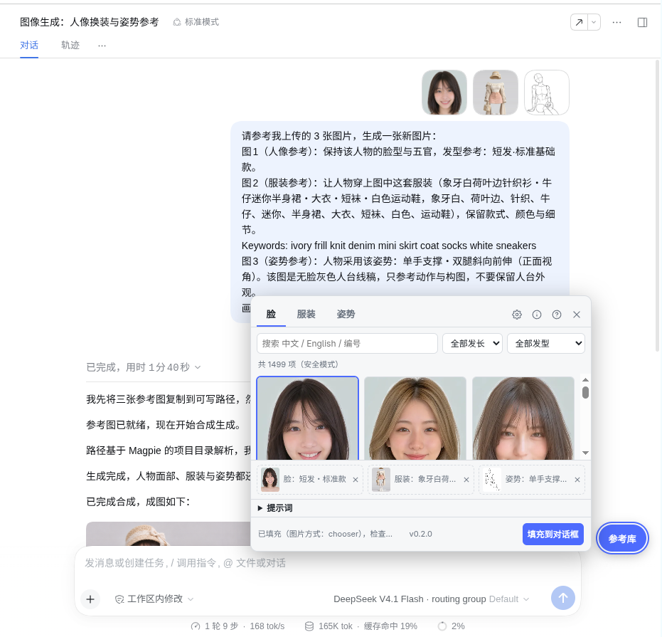

# dsh-ref-autofill

DeepSeek Harness 的**参考图一键填充**插件。

在 `dsh web` 里浏览中文 AI 参考图库（脸 / 服装 / 姿势，含多角度与深度图），选中后把**高清参考图 + 提示词**一键填入对话框，由你自己决定什么时候发送。

这是原油猴脚本 `dsh-ref-autofill.user.js` 的 DSH 插件版：UI、数据层和 DSH 站点适配逻辑原样保留，只是去掉油猴运行时依赖，改由 `dsh plugin` 安装、由 DSH 客户端加载。



## 功能

- **三个参考库**：脸（1499 项）/ 服装（3224 项）/ 姿势（153 项，安全模式开启时的数量）
- **搜索与两层筛选**：中文 / English / 编号全文检索，按发长·发型、大类·分类、体系·动作分类过滤
- **姿势多视角**：正面 / 俯视 / 仰视 / 侧面 / 斜侧；3D 白模 与 深度图（ControlNet Depth）切换
- **自动生成提示词**：按所选参考图拼出「图1 人像参考 / 图2 服装参考 / 图3 姿势参考」，可换风格预设、加补充描述、自由改写、一键复制
- **本地图片**：托盘里每个未选槽位可上传本地图片，与图库混搭
- **一键填充**：高清原图写入 DSH 输入框的附件区 + 提示词写入编辑器；重复填充自动去重
- **友好细节**：安全模式、参考图数量上限、面板可拖动/缩放/吸附、跟随 DSH 明暗主题、`Alt+Shift+R` 呼出

## 安装

从 GitHub 安装：

```sh
dsh plugin --profile web add github:dddaniel1/dsh-ref-autofill
dsh web
```

或在本地开发时：

```sh
dsh plugin --profile web add /path/to/dsh-ref-autofill
```

页面右下角出现「参考库」按钮，点击展开面板；`Alt+Shift+R` 亦可。

不需要安装任何用户脚本管理器，也不再需要 `@match` / `@connect` 声明：
插件只在 DSH 客户端里运行，网络请求走浏览器 `fetch`（三个数据源都返回
`Access-Control-Allow-Origin: *`）。

## 使用

1. 在「脸 / 服装 / 姿势」里点卡片选参考图（姿势可切角度/深度图）。
2. 需要时上传本地图片填空槽位。
3. 检查提示词，按需换风格或补充描述。
4. 点「填充到对话框」，核对输入框里的图片与文字，再自己点发送。

## 插件结构

```
dsh-ref-autofill/
  lib/index.js        Host 半边：空插件，让 bundle 进插件树
  lib/client.js       浏览器半边：原油猴脚本 + ModuleLoader 包装
  cordis.patch.yml    bundle patch
  test/e2e.js         在真实 DSH 页面里跑的自检（控制台调用 runE2E()）
```

浏览器半边由 `package.json` 的 `dsh.client` 声明，DSH web 客户端启动时加载。
存储从 `GM_getValue` 换成 `localStorage`（脚本原本就带这个降级），键名不变。

## 数据来源与授权

参考库数据来自开源项目 [anhao/ai-pose-gallery-zh](https://github.com/anhao/ai-pose-gallery-zh)：

- 姿势库、人像脸库、写实/动漫穿搭：ギア [@giaaibusi](https://x.com/giaaibusi)
- 中国历代服饰：Shisei（[shiseicostume.com](https://www.shiseicostume.com/)，CC0）
- 二次元服装：たき AI [@taki_auto](https://x.com/taki_auto) · CharaDB

插件运行时按需从公开 CDN 读取数据与图片，不打包、不转储、不再分发任何图片。
人像脸库与中国历代服饰为 CC0；姿势库、其余服装库图片**禁止二次分发**。

参考产品形态来自 Greasyfork 上的《AI 生图参考图一键填充》（作者 yjiace，MIT）；
本插件是面向 DeepSeek Harness 的独立重写与插件化移植。

## License

MIT
